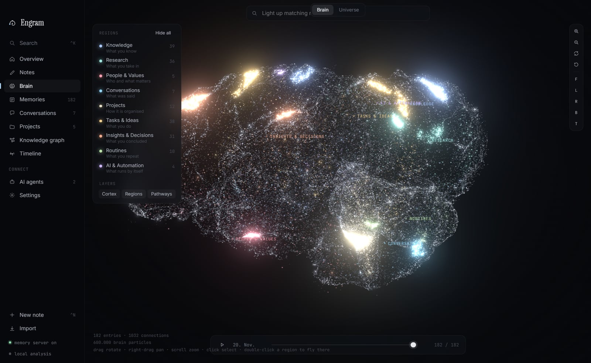

# Engram

**A local-first second brain with a living 3D memory map and an MCP memory server for AI agents.**

Engram keeps your notes, projects and AI conversations in a local database and draws them as a 3D particle brain. Every glowing point is a real entry you can open. Agents such as Claude Code, Claude Desktop, Cursor and Codex read and write the same memory over MCP.

🌐 **Website:** https://klardon972.github.io/engram/

## Status

Engram is in active development. There is no public download yet.

## Highlights

- **Two worlds:** an anatomical particle brain where regions glow where your entries live, and a star field orbiting a real-time raymarched black hole
- **Notes vault:** live-preview Markdown, `[[wikilinks]]`, backlinks, tabs, templates, daily notes
- **Import:** ChatGPT, Claude, Gemini, Claude Code, Codex, Obsidian, Notion, Evernote, WhatsApp, Kindle and more
- **Search & ask:** hybrid full-text and vector search with cited answers
- **Agent memory:** MCP tools over stdio and Streamable HTTP, one-click setup
- **Private:** no account, no server, no telemetry; end-to-end encrypted sync

---

This repository hosts the Engram website (GitHub Pages).
